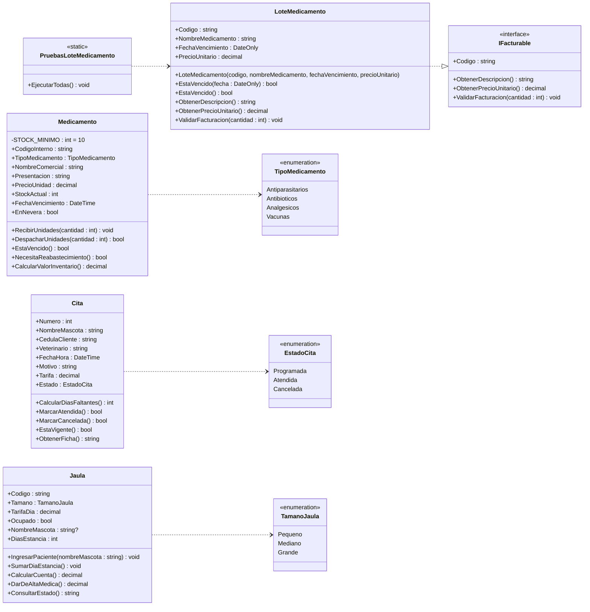

# PetCare 2.0 · Todo se cobra en la misma factura

Producto de la Unidad 2 · Programación Orientada a Objetos (SD1007) · Grupo 053 · 2026-II
Institución Universitaria Pascual Bravo · Docente: Jorge Albeiro Muriel Vélez

## Integrantes

| Integrante | Responsabilidad |
|---|---|
| Ader | Servicios y reglas de cobro: `Servicio`, `CitaVeterinaria`, `Hospitalizacion` |
| Adel Ramos | Medicamentos e interfaz: `LoteMedicamento`, `IFacturable` y sus pruebas |
| Wilson Caraballo | Facturación: `Factura`, `RenglonFactura`, anulación |
| Luis | Integración, `Main` de demostración, diagrama UML, historias de usuario, `DISENO.md` e `IA.md` |

## Cómo ejecutarlo

Requiere .NET 10.

```bash
git clone https://github.com/AdelRamos-coder/TallerPetCare.git
cd TallerPetCare
dotnet run
```

En el menú, la opción **6** ejecuta las pruebas de `LoteMedicamento`.

## Avance

| Parte | Estado |
|---|---|
| Clases de la Unidad 1 corregidas (`Cita`, `Jaula`, `Medicamento`) | Hecho |
| `IFacturable` | Hecho |
| `LoteMedicamento` + pruebas | Hecho |
| `Servicio` (abstracta), `CitaVeterinaria`, `Hospitalizacion` | Pendiente |
| `Factura`, `RenglonFactura` | Pendiente |
| `Main` con los 8 pasos de la demostración | Pendiente |
| `DISENO.md`, `IA.md`, historias de usuario, diagrama en draw.io | Pendiente |

## Diagrama de clases · estado actual

Este diagrama muestra **lo que hay hoy en el código**. Se actualiza cada vez que se sube una clase nueva.



### Cómo leer las flechas

| Flecha | Relación | Significado aquí |
|---|---|---|
| Punteada con triángulo vacío | Realización | `LoteMedicamento` cumple el contrato `IFacturable` |
| Punteada con flecha abierta | Dependencia | La clase usa el enum o la otra clase |

## Lo que sigue (en construcción)

Cuando se suban las clases de los demás, el diagrama va a crecer así:

- `Servicio` «abstract» **implementa** `IFacturable`, y `CitaVeterinaria` y `Hospitalizacion` **heredan** de `Servicio`. Así la interfaz queda cumplida por dos jerarquías distintas: la de servicios y `LoteMedicamento`.
- `Factura` ◆ `RenglonFactura` (**composición**): la factura crea y controla sus renglones; desde afuera solo se leen.
- `RenglonFactura` ◇ `IFacturable` (**agregación**): la consulta, la hospitalización o el lote llegan ya creados y siguen existiendo si la factura se anula.

## Reglas de negocio implementadas

| Clase | Regla |
|---|---|
| `LoteMedicamento` | Un lote vencido no se puede vender, ni una unidad |
| `LoteMedicamento` | El día del vencimiento todavía se vende; desde el día siguiente no |
| `LoteMedicamento` | Código y nombre obligatorios, precio mayor que cero, cantidad mayor que cero |
| `Medicamento` | No se despacha si está vencido, si la cantidad es 0 o si supera el stock |
| `Cita` | Solo una cita programada se puede atender o cancelar |
| `Jaula` | No entra un segundo paciente a una jaula ocupada; se cobra mínimo un día |
