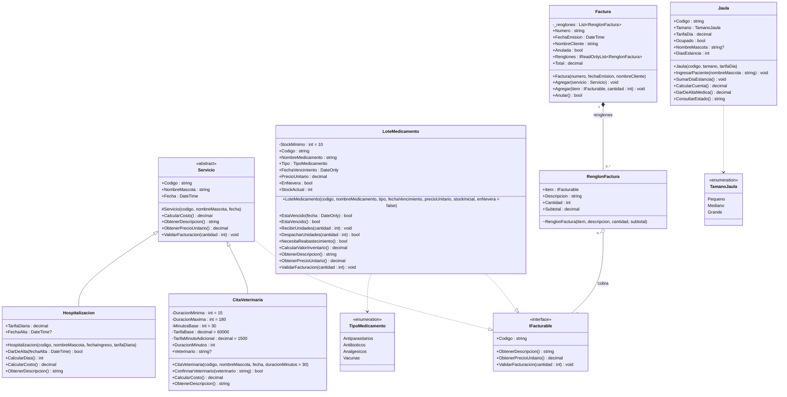

# PetCare 2.0 · Todo se cobra en la misma factura

Producto de la Unidad 2 · Programación Orientada a Objetos (SD1007) · Grupo 053 · 2026-II
Institución Universitaria Pascual Bravo · Docente: Jorge Albeiro Muriel Vélez

## Integrantes

| Integrante | Responsabilidad |
|---|---|
| Ader | Servicios y reglas de cobro: `Servicio`, `CitaVeterinaria`, `Hospitalizacion` |
| Adel Ramos | Medicamentos e interfaz: `LoteMedicamento`, `IFacturable` |
| Wilson Caraballo | Facturación: `Factura`, `RenglonFactura`, anulación |
| Luis | Integración, `Main` de demostración, diagrama UML, historias de usuario, `DISENO.md` e `IA.md` |

## Cómo ejecutarlo

Requiere .NET 10.

```bash
git clone https://github.com/AdelRamos-coder/TallerPetCare.git
cd TallerPetCare
dotnet run
```

`dotnet run` ejecuta la demostración de los 8 pasos.

## Avance

| Parte | Estado |
|---|---|
| `Medicamento` de la Unidad 1 unido a `LoteMedicamento` | Hecho |
| `Jaula` de la Unidad 1 corregida | Hecho |
| `IFacturable` | Hecho |
| `LoteMedicamento` | Hecho |
| `Servicio` (abstracta), `CitaVeterinaria`, `Hospitalizacion` | Hecho |
| `Factura`, `RenglonFactura` | Hecho |
| `Main` con los 8 pasos de la demostración | Hecho |
| `DISENO.md`, `IA.md`, historias de usuario, diagrama en draw.io | Pendiente |

## Diagrama de clases · estado actual

Este diagrama muestra **lo que hay hoy en el código**. Se actualiza cada vez que se sube una clase nueva.



Los métodos con `*` son abstractos.

### Cómo leer las flechas

| Flecha | Relación | Significado aquí |
|---|---|---|
| Línea continua con triángulo vacío | Herencia | `CitaVeterinaria` y `Hospitalizacion` **son** servicios |
| Punteada con triángulo vacío | Realización | `Servicio` y `LoteMedicamento` cumplen el contrato `IFacturable`, sin ser de la misma familia |
| Rombo relleno ◆ | Composición | La factura es dueña de sus renglones |
| Rombo vacío ◇ | Agregación | El renglón apunta a algo que existe por su cuenta |
| Punteada con flecha abierta | Dependencia | La clase usa el enum o la otra clase |

### Composición y agregación

- `Factura` ◆ `RenglonFactura` (**composición**, 1 a 0..*): la factura crea y controla sus renglones; desde afuera solo se leen. Si la factura se anula, sus renglones ya no sirven para otra.
- `RenglonFactura` ◇ `IFacturable` (**agregación**, 0..* a 1): la consulta, la hospitalización o el lote llegan ya creados y siguen existiendo si la factura se anula, así que se pueden facturar de nuevo.

## Reglas de negocio implementadas

| Clase | Regla |
|---|---|
| `CitaVeterinaria` | Vale $60.000 hasta 30 minutos y $1.500 por cada minuto adicional |
| `CitaVeterinaria` | La duración va de 15 a 180 minutos y arranca en 30 |
| `CitaVeterinaria` | El veterinario se asigna una sola vez al confirmar |
| `Hospitalizacion` | Se cobra por días entre ingreso y alta (o hasta hoy), mínimo un día |
| `Hospitalizacion` | El alta se da una sola vez y no puede ser anterior al ingreso |
| `Servicio` | Siempre se factura como una unidad |
| `Factura` | Una factura anulada no admite más renglones |
| `Jaula` | No entra un segundo paciente a una jaula ocupada; se cobra mínimo un día |
| `Factura` | Al agregar una consulta no se escribe la cantidad: el sistema asume 1 |
| `LoteMedicamento` | Un lote vencido no se puede vender, ni una unidad |
| `LoteMedicamento` | El día del vencimiento todavía se vende; desde el día siguiente no |
| `LoteMedicamento` | Código y nombre obligatorios, precio mayor que cero, cantidad mayor que cero |
| `LoteMedicamento` | No se factura ni se despacha más de lo que hay en stock |
| `LoteMedicamento` | No se despacha si está vencido o si la cantidad es 0; avisa cuando quedan menos de 10 unidades |
